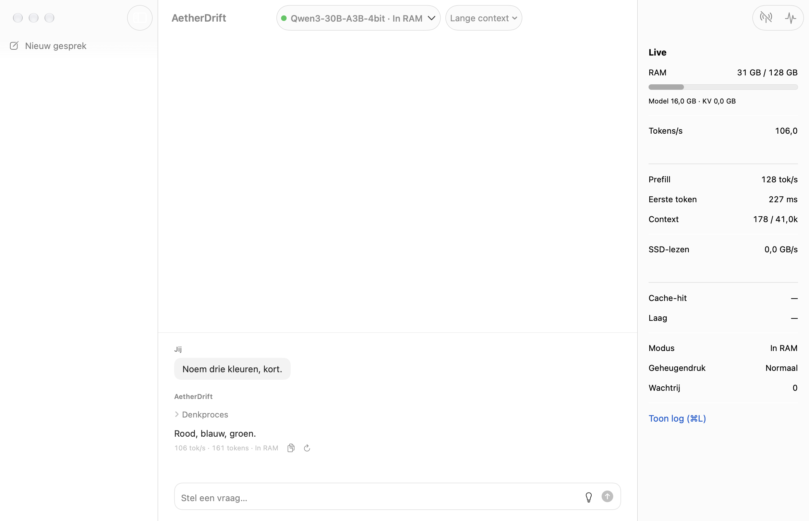

# AetherDrift

*Infinite Intelligence. Local Hardware.*

[English](README.md) · **Nederlands**

AetherDrift draait grote taalmodellen lokaal op een Mac met Apple Silicon. Modellen die in het geheugen passen, draaien op volle snelheid. Grotere modellen worden via de Drift Engine vanaf de SSD gestreamd, zelfs GLM 5.3 (418 GB) op een Mac met 128 GB. Andere apparaten gebruiken het model via de webchat (QR-code), een OpenAI-compatibele API of de Ollama-API.



> Status: M0–M5 zijn gebouwd. Van M6 zijn de menubalk, de snelchat (⌥Spatie), Nederlands/Engels en een zelfstandige runtime klaar; signeren en notariseren wachten op een Developer ID. Zie [doc/ARCHITECTURE.md](doc/ARCHITECTURE.md).

## Vereisten

- Een Mac met Apple Silicon (M1 of nieuwer) en macOS 14 of nieuwer.
- Vrije SSD-ruimte voor de modellen die je downloadt.
- Zelf bouwen: Xcode, `uv` en XcodeGen (`brew install uv xcodegen`).

## Installeren

Download de zip bij [Releases](https://github.com/mfidder2026/AetherDrift/releases), pak hem uit en zet AetherDrift in Apps. De app heeft een eigen Python-runtime aan boord en werkt zonder internet.

De app is nog niet gesigneerd met een Developer ID, dus macOS blokkeert de eerste start. Ga naar Systeeminstellingen → Privacy en beveiliging en klik op **Open toch**, of voer uit:

```bash
xattr -dr com.apple.quarantine /Applications/AetherDrift.app
```

## De app bouwen

```bash
./scripts/build-app.sh            # bouwt en test; de app staat in app/build/Build/Products/Debug/
open app/build/Build/Products/Debug/AetherDrift.app
./scripts/build-app.sh Release    # met eigen Python-runtime: werkt zonder internet (ADR-007)
```

De app start de engine zelf. Er is geen terminal nodig. Een Debug-build installeert de runtime bij de eerste start (eenmalig internet), een Release-build heeft hem al aan boord.

## Andere apparaten verbinden

Kies in de app **Verbind een apparaat** (⌘⇧C) en zet **Delen op netwerk** aan. Scan de QR-code met je telefoon om de webchat te openen, of gebruik de base URL plus de API-sleutel in elke OpenAI-compatibele app (Open WebUI, LibreChat, Continue). Ollama-clients gebruiken dezelfde poort zonder `/v1`. Via het netwerk zijn alleen de chat-API's bereikbaar; beheer kan alleen op de Mac zelf (ADR-006).

## Snelheid van grote modellen

Past een model niet in het geheugen, dan leest de Drift Engine het tijdens het rekenen van de SSD, en is de SSD de grens. GLM 5.3 (418 GB) op een Mac met 128 GB haalt zo 1,2–1,4 tokens per seconde, met Turbo ongeveer 3. Na een nieuwe vraag duurt het 10–30 seconden voor het eerste woord verschijnt, met Turbo 6–15 ([meting](bench/reports/2026-10-27-GLM-speed.md)).

- **Nadenken** (lampje naast het invoerveld): modellen zoals GLM en Qwen3 kunnen eerst nadenken. Via Drift kan dat vele minuten kosten. Daarom slaat *Automatisch* het nadenken over voor Drift-modellen. Apps kiezen het zelf met `reasoning_effort` (OpenAI) of `think` (Ollama).
- **Turbo** (modusmenu in de werkbalk): slaat experts over die nog niet in het geheugen staan en weinig bijdragen. GLM 5.3 wordt zo ongeveer twee keer zo snel. De antwoorden wijken iets af, vergelijkbaar met een grovere quantisatie. Turbo staat standaard uit.
- **Past het model in het RAM**, dan is het tientallen keren sneller. GLM 5.3 past (bijna) helemaal in een Mac met 512 GB.

## Alleen de engine (ontwikkelaars)

```bash
./scripts/bootstrap.sh
./scripts/dev-engine.sh --model mlx-community/Qwen2.5-0.5B-Instruct-4bit
```

```bash
curl -N http://127.0.0.1:8080/v1/chat/completions \
  -H 'Content-Type: application/json' \
  -d '{"model":"default","messages":[{"role":"user","content":"Hallo!"}],"stream":true}'
```

Elke OpenAI-compatibele client werkt met base URL `http://127.0.0.1:8080/v1`. Live statistieken: `curl -N http://127.0.0.1:8080/aether/v1/stats/stream`. API-documentatie: <http://127.0.0.1:8080/docs>.

## Testen en meten

```bash
./scripts/test.sh                                   # lint + tests
uv run --project engine python bench/ssd.py         # SSD-snelheid
uv run --project engine python bench/generate.py --model mlx-community/Qwen3-30B-A3B-4bit
uv run --project engine python bench/drift.py --model mlx-community/Qwen2.5-7B-Instruct-4bit --weights-budget 2GB
```

## Documenten

- [start-prompt-v2.md](doc/start-prompt-v2.md): het ontwerp en de mijlpalen
- [doc/ARCHITECTURE.md](doc/ARCHITECTURE.md): wat er gebouwd is en waar het afwijkt
- [doc/adr/](doc/adr/): architectuurbeslissingen
- [bench/reports/](bench/reports/): meetresultaten
